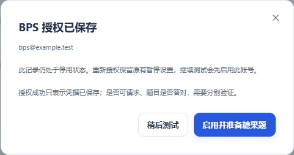

# BPS 原题复测案例：2026-11-27

这是一个真实账号的纵向观察，已去除账号标识和凭据。它支持“本次 BPS 糖果题回答改善”的结论；不能据此判定固定冷却时长、唯一原因或永久恢复。

## 观察顺序

| 北京时间 | 实际操作或结果 |
| --- | --- |
| 11 月 26 日 | 历史记录中原生糖果题曾回答 29；当日另一次 BPS 40/40 后原生回答 21。各轮结果分别留存，不能当成本次结果。 |
| 11 月 27 日凌晨至下午 | 同账号 BPS 多次原题测试返回 28／29；部分请求 Astra 时，返回模型标识为 Luna。模型标识本身不能证明内部权重或质量。 |
| 14:43 | 在 ChatGPT 网页完成“退出全部设备”，观察到登录会话过期。随后停用本地授权记录，避免后台维护请求。 |
| 19:21 | 约 4.6 小时后一次 BPS 请求被拒绝，明确返回 OAuth token invalidated。没有生成答案，因此没有质量结论。 |
| 22:42 | 重新完成 BPS 授权。同邮箱、用户和工作区，独立 BPS grant 已保存。 |
| 随后 | 原生授权要求无法取得的邮箱验证码；未完成新的原生授权，未生成本轮原生答案。 |
| 22:55 | 按用户要求直接测试纯 BPS；未执行新一轮 40 次预热。原题返回 21，12 颗五角星形 + 9 颗圆形，策略和 20 颗不能保证的证明均通过人工核对。 |

最后一次请求为 `gpt-6-astra`、`medium`，实际路由 `bps`、HTTP 200、耗时 27.812 秒，返回模型标识也是 `gpt-6-astra`。测试使用同版桌面后端的隔离实例，无自动刷新、额度探针、原生回退或额外答案提示。

原题 SHA256：`cd771ba38f8f75696ba703c7d3e91e5273588c91cb8c4145e3ce4b077c075c3f`。

## 结论边界

可以确认：此前同账号有错误回答，本次退出设备、间隔一段时间并重新授权后的 BPS 原题样本答对了。退出设备到成功样本约 8 小时 12 分钟，期间有一次失败的提前复测，不是完整无请求的 24 小时冷却实验。

尚未确认：由退出设备、等待、重新授权或其它上游状态中的哪一项造成变化；恢复是否持续；同一时刻原生通道能否答对。原生与 BPS 的历史记录构成案例背景，但本轮缺少同步原生对照。

## 客户端流程

保存基线原文 → 自行在网页退出全部设备 → 停用该账号各条授权并记录时间 → 等待后重新授权 BPS → 核对身份和启用状态 → 点击准备原题 → 明确启动测试 → 分别保存请求成功、通道、返回模型与答案判定。

不要把授权成功、预热完成、HTTP 200、返回模型名称与题目通过合并成一个“恢复成功”状态。单题自动评分仅识别结论，仍需查看策略与证明。

下面是合成账号的界面示意，用于展示重新授权后保留暂停状态；它不是上面真实样本的推理截图：

