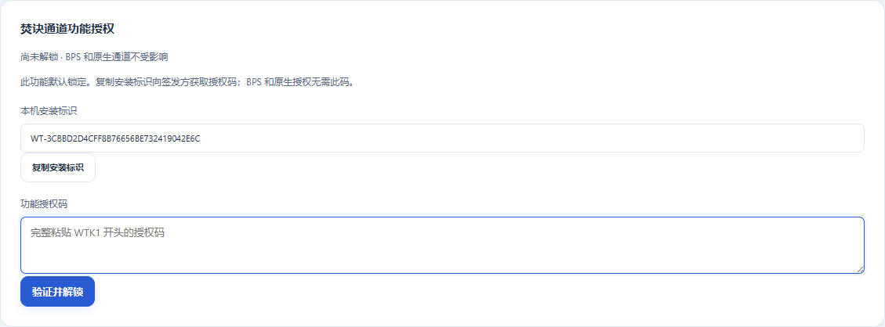

# 焚诀功能授权

Preview.6 起，焚诀通道默认锁定。BPS、原生 Codex 和已有账号数据不受功能锁影响。

## 使用者

1. 打开 **设置 → 焚诀通道功能授权**，复制本机安装标识。
2. 向签发方获取对应此安装、带有效期的 `WTK1` 授权码。
3. 完整粘贴后点击 **验证并解锁**。成功后显示到期时间。

功能授权码与第三方登录设备码是不同的凭据。解锁功能之后，仍需完成账号登录、订阅绑定和实际请求验证。

下面是使用临时安装标识的合成测试截图，不包含可用授权码：



移除本地功能授权会重新锁定新操作，不删除账号。到期、签名错误、安装标识不匹配或缺少验签配置均保持锁定。未解锁时，直接调用管理接口、旧通道别名、模型后缀或已有启动配置也不能发出焚诀请求。

## 签发方

签名采用 Ed25519。客户端只包含验签公钥 `internal/featurelicense/verify-key.txt`；私钥必须保留在仓库及安装包之外，并独立备份。不要将私钥交给使用者。更换公钥会使旧公钥签发的码失效，因此不要重新初始化正在使用的签发方。

首次创建一套自己的签发密钥（已有密钥时不要执行）：

```powershell
node scripts/feature-license.cjs init --private-key "$env:USERPROFILE/.wishtoken-license-issuer/fenjue-ed25519.pem" --public-key internal/featurelicense/verify-key.txt
```

本次构建的公钥已配置。签发一份 30 天授权，替换 `WT-...` 为使用者复制的完整安装标识：

```powershell
node scripts/feature-license.cjs issue --private-key "$env:USERPROFILE/.wishtoken-license-issuer/fenjue-ed25519.pem" --installation WT-... --days 30 --out "$env:USERPROFILE/.wishtoken-license-issuer/customer-code.txt"
```

命令拒绝覆盖现有输出，授权码写入指定文件，不在终端日志中打印。天数可指定 1–3650；没有内置通用码或开发后门。

这是离线、按安装标识绑定的功能许可，并非在线发卡或全局撤销服务。安装标识随数据目录保存；迁移整个数据目录会一起迁移它。到期判断使用本机时间。功能许可不替代上游账号权限，也不保证账号请求质量。

## 验证

后端测试使用临时签发密钥，覆盖默认锁定、伪造签名、跨安装、过期、未来时间、重启保留、移除授权、管理接口和推理入口。GUI 验证需提供本次测试构建公钥所对应的私钥路径；仅对临时安装签发测试码：

```powershell
$env:WISHTOKEN_TEST_ISSUER_KEY = "$env:USERPROFILE/.wishtoken-license-issuer/fenjue-ed25519.pem"
node desktop/test/feature-gate-ui-smoke.cjs
```

测试私钥不进入渲染进程、HTTP 响应或发布目录。
